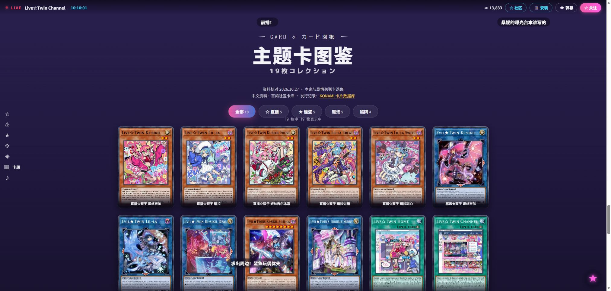
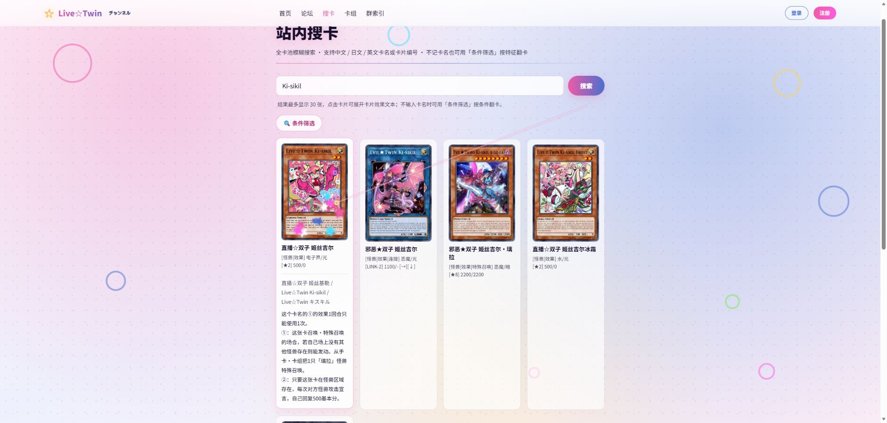
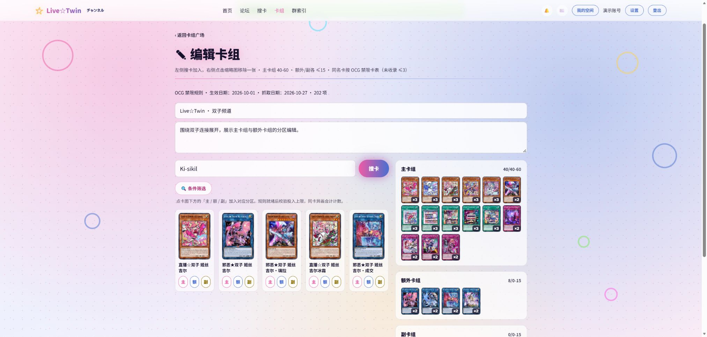

<p align="center">
  
</p>

<h1 align="center">Live☆Twin Community</h1>

<p align="center"><strong>把主题交互、社区交流与卡组工具放进同一个全栈项目。</strong></p>

<p align="center">Python · Flask · SQLAlchemy · SQLite · 原生 JavaScript · GSAP · PWA</p>

<p align="center"><a href="https://github.com/AriaEternity/live-twin-community/actions/workflows/ci.yml"></a></p>

> 封面是 AI 生成的装饰视觉；下方截图展示项目的真实界面。项目为非官方粉丝作品，角色、卡片与相关素材的权利说明见 [第三方素材说明](THIRD_PARTY_NOTICES.md)。

Live☆Twin Community 是一个以游戏王 Live☆Twin / Evil★Twin 为主题的社区与卡片工具站。访客可以浏览角色档案和主题卡册，按名称或多维条件检索卡片；登录后可以发帖、回复、私信、收藏与关注，并创建和分享卡组。

仓库收录经过脱敏的程序、公开卡片快照、测试和演示资料。业务数据库、用户上传、真实联系目录、生产凭据与私有运维记录不随仓库发布。

## 看看实际界面

### 主题卡册

主题首页使用原生 JavaScript、CSS tokens 与 GSAP 组织场景、动效和卡片详情。主题卡选集共 19 张，分类数量从同一份数据派生，桌面与手机使用不同布局。



### 搜卡与条件筛选

支持中文、日文、英文卡名与卡片编号查询，也可以组合卡种、属性、种族、星级、连接、灵摆刻度、攻防和禁限条件。结果包含效果文本和 OCG 禁限角标。



### 卡组构筑

编辑器复用搜卡接口，将卡片加入主卡组、额外卡组或副卡组。同一张卡的不同图号会归一后合计投入数量；规则加载异常时暂停保存并保留编辑内容。



## 已实现的功能

| 领域 | 内容 |
| --- | --- |
| 主题前端 | 场景导航、角色档案、主题卡册、分类筛选、详情弹层、弹幕与粒子、移动布局、减少动效偏好 |
| 社区交流 | 板块、主题、回复、图片附件、点赞、收藏、关注动态、个人空间、@提及、楼层引用、通知 |
| 账号与私信 | 注册登录、昵称与头像设置、密码哈希、站内私信与图片附件、未读数量 |
| 卡片工具 | 名称/编号检索、多维条件筛选、分页、效果原文、当前 OCG 禁限展示 |
| 卡组工具 | 主/额/副三区编辑、容量与投入上限校验、同卡异画归一、详情与链接分享 |
| 管理与基础机制 | 用户与内容管理、公告、管理日志、POST CSRF、持久化速率限制、可配置文本过滤 |

## 三个值得展开的工程点

### 1. 搜索缓存与构筑保存使用当前规则

关键词查询缓存保留 7 天，但响应中的禁限状态会按当前规则重新计算。禁限数据分别保留官方密码、主卡 ID 与异画映射；构筑保存时跨主/额/副三区按归一 ID 合计，避免同一卡片因编号不同绕过上限。

规则文件损坏时保留进程内最后一份有效规则并标记 `stale`；首次没有有效规则则明确返回 503，编辑器提示重试，不把未知状态当成全部允许。

### 2. 搜卡上游异常时有清楚的回退路径

搜卡优先使用有效关键词缓存。需要访问远端而上游异常时，先尝试既有关键词缓存；没有对应缓存时，再检索本地真实效果文本快照。页面会显示快照日期，本地回退不会伪装成新鲜远端查询结果，也不会写入远端查询缓存。

### 3. 数据维护具有来源与失败保护

属性来自 YGOPRODeck，中文资料与效果文本来自百鸽，OCG 规则对照 Konami 已生效完整名单。刷新脚本校验全量结果、唯一正 ID、解压 JSON 的 MD5、异常缩减、卡片关联与规则分档，核验后逐文件原子替换。

官方简中名 `sc_name`、社区译名 `cn_name` 与旧译名保留有明确优先级；缺少可靠资料时不推测补写。

## 技术与架构


详细节点和搜卡回退流程的Mermaid源码见 [架构说明](docs/architecture.md)。

程序按 Blueprint 划分业务，SQLAlchemy 中有 16 个持久化模型。详细数据流、规则契约和边界见 [架构说明](docs/architecture.md)。

## 本地启动

需要 **Python 3.10+**。Node.js 只用于运行 JavaScript 测试，启动网站不需要前端打包步骤。

克隆本仓库后，在仓库根目录创建虚拟环境：

```bash
python -m venv .venv
```

Windows PowerShell 激活：

```powershell
.venv\Scripts\Activate.ps1
```

macOS / Linux 激活：

```bash
source .venv/bin/activate
```

安装并启动：

```bash
python -m pip install -r requirements.txt
python app.py
```

打开 [本地网站](http://127.0.0.1:8080)。程序首次启动会创建本地数据库和默认板块。开发入口只监听本机，并使用开发会话密钥；生产模式必须显式配置 `SECRET_KEY`。代码不会自动加载 `.env`。

注册始终创建普通用户。需要管理权限时，先在本地注册账号，再通过 CLI 显式授予，见 [本地开发与配置](docs/local-development.md)。仓库不提供默认管理员口令。

## 公开卡片快照

以下为 **2026-10-27** 的资料快照，不代表实时更新：

| 项目 | 数量 / 日期 |
| --- | ---: |
| 属性记录 | 14,645 |
| 有中文名的属性记录 | 14,359 |
| 本地真实效果原文 | 14,255 |
| OCG 禁限规则 | 202：禁止 94 / 限制 95 / 准限制 13 |
| OCG 规则生效日 | 2026-10-01 |
| 同卡异画归一映射 | 172 |
| 首页主题选集 | 19 |

属性库包含先行、临时编号及其他格式的记录，**不是已发售 OCG 卡片数量**。资料来源：[YGOPRODeck API](https://ygoprodeck.com/api-guide/)、[百鸽 API](https://ygocdb.com/api)、[Konami OCG 禁限表](https://www.yugioh-card.com/japan/event/limitregulation/index.php?list=202610)。

更新前应先生成候选数据并审核，再替换应用使用的快照。具体命令见 [数据维护与验证](docs/local-development.md#数据维护)。

## 测试与验证

公开副本在2026-10-28本地实跑：**Python 39项、编辑器8个场景、SW逻辑/HTTP 7项、五模块业务冒烟529项均通过**。GitHub Actions状态由上方动态徽章显示，本地结果与远端CI分别记录；范围见 [验证说明](docs/validation.md)。

Python 离线回归：

```bash
python -B -X utf8 -m unittest discover -s tests -p 'test_*.py' -v
```

构筑器交互与 Service Worker 契约：

```bash
node --test tests/test_deck_editor_rules.mjs
node --test tests/test_sw_contract.mjs
```

网站启动后，可以额外检查应用壳 HTTP 资源：

```bash
node tests/test_sw_contract.mjs http://127.0.0.1:8080
```

业务冒烟使用独占副本、合成数据库和临时上传目录：

```bash
python -B -X utf8 scripts/run_isolated_smoke.py
```

隔离 runner 覆盖论坛、私信、社交、卡组与筛选。不要在含业务数据的目录中直接运行旧 `smoke_*.py`。测试范围和浏览器验收建议见 [本地开发与配置](docs/local-development.md#测试)。

## 项目边界

- 构筑器提供容量与 OCG 投入上限辅助校验，不是完整赛事合法性裁判；未强制验证全部卡片存在性、卡种分区和发售状态。
- PWA 缓存应用壳与已访问的静态资源，动态社区数据、全量卡图及外部资源不保证离线可用。
- 数据更新是逐文件原子替换，不是多文件事务；运行中的应用需要避免读取混合版本。
- 上游卡片服务、字体与动画 CDN 可能不可用，实时搜索和部分视觉资源受网络影响。
- 文本过滤需要使用者自行配置词表，公开仓库不携带生产词库。

## 作品使用与素材说明

**暂未指定代码开源许可证**；公开源码不等于授予任意复制、修改或分发许可。第三方角色、卡图、数据、字体、依赖及 AI 装饰素材分别见 [THIRD_PARTY_NOTICES.md](THIRD_PARTY_NOTICES.md)。

用于简历时，可参考 [项目表述与面试讨论点](docs/resume-notes.md)，并按本人实际承担的职责调整，不应把示例文字直接当作个人贡献证明。
