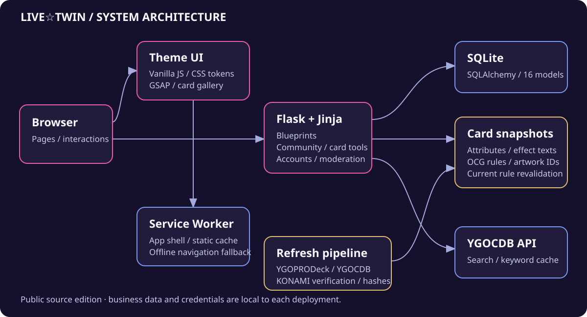

# 架构与数据流

本项目由主题首页、Flask 社区和卡片工具组成。主题页保留独立的原生前端结构；社区页面使用 Jinja 服务端渲染，搜卡、筛选和卡组编辑使用 JSON 接口与浏览器脚本协作。

## 组件关系



以下为可复制到Mermaid工具的流程源码：

```text
flowchart TB
    Browser[浏览器]
    Browser --> Static[主题前端<br/>index.html / css / js]
    Browser --> Flask[Flask 应用]
    Static --> SW[Service Worker]
    Flask --> Auth[账号与会话]
    Flask --> Community[论坛 / 社交 / 私信 / 管理]
    Flask --> Cards[卡片检索与条件筛选]
    Flask --> Decks[卡组编辑与规则校验]
    Auth --> DB[(SQLite)]
    Community --> DB
    Cards --> Cache[关键词查询缓存]
    Cache --> DB
    Cards --> Remote[百鸽搜索 API]
    Cards --> Local[本地属性与效果快照]
    Cards --> Rules[OCG 规则与异画映射]
    Decks --> Rules
    Decks --> DB
    Pipeline[数据刷新脚本] --> Verification[全量 / 唯一 ID / MD5<br/>官方名单 / 分档 / 生效日期]
    Verification --> Local
    Verification --> Rules
```

## 目录分工

| 位置 | 职责 |
| --- | --- |
| `app.py` | 创建 Flask 应用、注册 Blueprint、CSRF 钩子、模板过滤器、错误页，初始化表与板块 |
| `config.py` | 从进程环境读取运行配置，区分开发与生产会话设置 |
| `models.py` | SQLAlchemy 模型，含业务关系、查询缓存与限速记录 |
| `security.py` | POST CSRF、密码强度规则、按用途和 IP 的持久化限速 |
| `routes/` | 账号、论坛、私信、搜卡、卡组、群索引、管理与静态资源路由 |
| `templates/` | Jinja 页面、公共布局与组件 |
| `js/`、`css/` | 主题交互、卡片筛选、构筑器、动效和样式 |
| `data/` | 公开卡片属性、真实效果文本、禁限与异画快照 |
| `scripts/` | 资料维护和隔离业务验证 |
| `tests/` | 公开源码的离线语义与交互回归 |

`app.py` 提供 `create_app()`，但模块末尾也会创建应用实例。应用初始化会建目录、执行 `db.create_all()` 并播种默认板块，因此导入应用入口有文件和数据库副作用；测试或脚本必须先设置独立配置。

## 持久化模型

当前有 16 个 SQLAlchemy 模型：

| 领域 | 模型 |
| --- | --- |
| 用户与内容 | `User`、`Board`、`Thread`、`Post`、`Attachment` |
| 社交关系 | `Like`、`Favorite`、`Follow` |
| 消息与通知 | `Notification`、`PrivateMessage`、`MessageAttachment` |
| 内容与管理 | `Deck`、`ModerationLog`、`Announcement` |
| 基础数据 | `RateHit`、`CardQueryCache` |

点赞、收藏和关注关系使用唯一约束防止重复。限速使用独立数据库事务读写，不提交或回滚调用方待处理的业务对象；查询缓存写入失败时会回滚缓存事务，仍尽力返回已取得的卡片结果。

首次启动只创建缺失表，`db.create_all()` 不是已有表的自动字段迁移机制。已有数据库的结构变更需要单独评估和迁移。

## 账号与运行配置

注册接口只创建普通用户。管理员资格通过本地 CLI 对已注册账号显式授予，不以公开默认用户名或默认口令分配。

开发入口默认监听 `127.0.0.1`，开发模式允许临时随机会话密钥。生产启动必须设置 `SECRET_KEY`，不会回退到公开固定值。配置读取进程环境，不自动加载 `.env`。

默认不信任客户端传入的代理头。只有位于一个受控反向代理之后时，才设置 `TRUST_PROXY_HEADERS=1`，信任一层转发；同时应通过网络配置保证应用端口不能被不受信任的请求直接访问。

## 搜卡的读取顺序

```text
flowchart TD
    Request[查询词与筛选参数] --> ValidRules{存在有效规则?}
    ValidRules -- 否 --> Unavailable[503，明确不可校验]
    ValidRules -- 是 --> Fresh{有效关键词缓存?}
    Fresh -- 是 --> Apply[应用当前禁限与筛选]
    Fresh -- 否 --> Remote[访问百鸽搜索 API]
    Remote -- 成功 --> Cache[尝试更新关键词缓存]
    Cache --> Apply
    Remote -- 异常 --> Old{存在旧关键词缓存?}
    Old -- 是 --> Stale[返回旧缓存并标记 stale]
    Stale --> Apply
    Old -- 否 --> Snapshot{本地原文快照有匹配?}
    Snapshot -- 是 --> Local[标明快照日期，不写远端查询缓存]
    Local --> Apply
    Snapshot -- 否 --> Failed[502，提示上游暂不可用]
    Apply --> Response[返回最多 30 条结果]
```

关键词缓存 TTL 为 7 天。缓存内容中的旧禁限档位不直接作为展示依据，响应会按当前规则重新计算；上游成功的结果、有效缓存和故障回退因此共享规则语义。

本地属性筛选单独读取属性快照，支持名称/编号和多维条件，每页 30 条。中文名称优先使用本地资料，缺少可靠中文名时保留已有英文兜底；部分缺名解析可能需要上游，因此本地属性文件不意味着所有路径都无网络请求。

## 禁限与同卡异画

禁限快照保留三类关联：

| 字段 | 含义 |
| --- | --- |
| `cards` | 主卡 ID 对应投入上限，值为 0、1、2 |
| `official_cards` | 官方名单关联到的原始卡片密码 |
| `aliases` | 异画或原密码到主 ID 的归一映射 |

例如一张卡的官方密码与属性库主图编号不同，检索时可以匹配归一后的 ID，构筑时按主 ID 计数，而用户卡组仍保留所选编号。

保存规则为主卡组 40–60 张、额外和副卡组各不超过 15 张。同卡跨三个分区合计：禁止 0、限制 1、准限制 2，规则未收录时上限为 3。严格正整数编号验证会拒绝布尔值、字符串、小数和超出 JavaScript 安全整数范围的值。

规则文件按文件签名重载，损坏时保留最后有效规则并标记过期状态；首次没有有效规则时不开放保存。编辑器会保留标题与卡片，允许重试。

这些是构筑辅助规则，不涵盖完整赛事合法性；没有强制验证全部卡片存在性、主/额卡种或发售状态。

## 数据维护管线

1. 从 YGOPRODeck 获取全量属性与图片 ID 关联，从百鸽获取公开资料 ZIP、解压 JSON 的 MD5 和禁限机器源。
2. 验证全量返回、正整数唯一 ID、异常缩减、中文资料完整性和主题卡覆盖。
3. 将禁限机器源中的官方 CID 关联到卡片，逐张比对 Konami 已生效完整名单，同时核验分档数量和生效日期。
4. 生成属性、真实效果文本、规则与异画映射候选，保留来源与抓取日期。
5. 全部核验后使用同目录临时文件、`fsync` 和 `replace` 逐文件写入。

中文名称优先级为官方简中 `sc_name`、社区译名 `cn_name`、已有译名。官方名称和社区翻译不是同一概念，不能笼统标为“全部官方中文”。

逐文件原子替换不等于整组事务。更新应用正在读取的整套数据时，应采用受控的版本切换或暂停读取，避免混合版本。

## PWA 与外部资源

Service Worker 预缓存 13 个应用壳路径；导航使用网络优先，失败时回退缓存首页或离线说明页。静态资源按访问缓存，POST、跨域请求和卡片 API 不由该缓存处理。

卡图不在全部应用壳中，外部字体与 GSAP 也不由同源 SW 完整接管。因此不能把“应用壳可离线打开”解释成全卡池、动态社区与所有图片均离线可用。

静态缓存匹配忽略查询参数，修改 HTML 的 `?v=` 本身不足以清除旧 SW 缓存；更新相关静态代码时需要同步更换 SW 缓存版本。

## 验证思路

- Python 回归使用合成记录验证数据来源、规则加载、缓存语义、本地回退和输入边界。
- 编辑器测试执行真实 JavaScript，在 VM 中验证加载、失败重试、跨区合计和内容保留。
- SW 契约测试覆盖缓存分支；HTTP 检查确认预缓存资源可达，但两者均不能单独证明浏览器已安装或离线导航成功。
- 业务冒烟通过独占源码副本、合成数据库、词表和上传目录运行，避免测试清理真实业务资料。
- 浏览器验收检查卡册/详情、搜卡、构筑交互、移动断点与减少动效设置；应区分实际执行、模拟和未覆盖场景。
